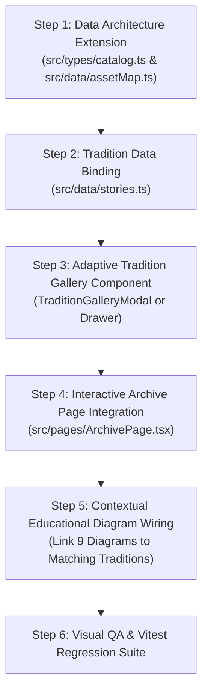

# EverThread — Phase 6.3.2.2 Six-Image Textile Catalogue Integration & Regression-Prevention Audit

**Document:** `phase_6_3_2_2_six_image_catalogue_integration_audit.md`  
**Audit Date:** October 21, 2026  
**Auditor:** Antigravity Pair Programming Agent (DeepMind)  
**Project:** EverThread Atelier E-Commerce Web Application (`FE Case Study`)  
**Mode:** STRICT AUDIT ONLY — Zero application code, styling, asset mappings, data, or tests modified.

---

## 1. Executive Summary

A forensic technical and art-direction audit was conducted on the approved six-image textile catalogue across all 13 Indian textile traditions, the 9 technical weaving diagrams, and their actual references and rendered behavior across all routes, data layers, and components in the EverThread codebase.

### Core Audit Discoveries

1. **Approved Asset Inventory Completeness:**  
   The project contains **78 approved base craft images** ($13\text{ traditions} \times 6\text{ semantic roles}$) and **260 responsive WebP variants** (`-400w` to `-1536w`), totaling **338 local files** in `public/images/archive/`. There are **zero missing files** across the 13 traditions.
2. **Massive Frontend Underutilization:**  
   Only **13 of the 78 base images ($16.7\%$)** are referenced in executable application code (`src/data/stories.ts`), strictly in the `macro-05` role for the 13 Weave Library cards on `/archive`. The remaining **65 approved craft assets ($83.3\%$)**—spanning model portraits, movement drapes, studio still lifes, and artisanal workshop process views—sit completely dormant and unrendered.
3. **Data Layer Disconnect:**  
   `src/data/assetCatalog.json` contains complete, verified metadata (including `src`, `srcSet`, `sizes`, `width`, `height`, and `alt`) for all 78 images across all 13 traditions. However, `src/data/assetMap.ts` exports `PRODUCT_ASSET_MAP` and `DIAGRAM_ASSETS` but **completely lacks an `ARCHIVE_ASSET_MAP` export**, preventing components from consuming these approved assets cleanly.
4. **Severe Aspect Ratio Heterogeneity (The Banarasi & Bandhani Landscape Trap):**  
   While 11 of 13 traditions feature portrait $1024 \times 1536$ ($0.67:1$, $2:3$) files for `model-01`, `model-02`, and `drape-03`:
   - **`banarasi-brocade`** is strictly **landscape $1536 \times 1024$ ($1.50:1$)** across `model-01`, `model-02`, and `drape-03`.
   - **`bandhani`** is **landscape $1374 \times 1145$ ($1.20:1$)** for `model-01` and `model-02`.  
   If upcoming implementation phases enforce rigid portrait containers with `object-fit: cover`, Banarasi and Bandhani model photographs will suffer **$>50\%$ horizontal truncation**, amputating models and garments.
5. **Technical Diagram Integration Status:**  
   All **9 approved technical diagrams** exist as scalable SVGs with PNG fallbacks in `public/images/weave-library/diagrams/`. They are wired to `ArchivePage.tsx` via `DIAGRAM_ASSETS` and an interactive visualizer (`diagram-viewer-panel`). However, they remain isolated on `/archive` and are not contextualized within individual craft traditions or stories.

---

## 2. 13-Tradition × 6-Image-Role Coverage Matrix

Each of the 13 traditions was audited against the six required semantic roles:
- `model-01`: Primary model portrait
- `model-02`: Alternate model view
- `drape-03`: Drape and movement
- `stilllife-04`: Textile still life
- `macro-05`: Weave and craft detail
- `process-06`: Making / loom / artisanal process

| Tradition (Folder) | `model-01` | `model-02` | `drape-03` | `stilllife-04` | `macro-05` | `process-06` | Total Base | Total Variants | Base Asset Status |
| :--- | :---: | :---: | :---: | :---: | :---: | :---: | :---: | :---: | :---: |
| **`ajrakh`** | $1024 \times 1536$ *(0.67:1 P)* | $1024 \times 1536$ *(0.67:1 P)* | $1024 \times 1536$ *(0.67:1 P)* | $1536 \times 1024$ *(1.50:1 L)* | $1536 \times 1024$ *(1.50:1 L) [Active]* | $1536 \times 1024$ *(1.50:1 L)* | 6 | 15 | 1 Active / 5 Dormant |
| **`bagru`** | $1024 \times 1536$ *(0.67:1 P)* | $1024 \times 1536$ *(0.67:1 P)* | $1024 \times 1536$ *(0.67:1 P)* | $1536 \times 1024$ *(1.50:1 L)* | $1536 \times 1024$ *(1.50:1 L) [Active]* | $1536 \times 1024$ *(1.50:1 L)* | 6 | 15 | 1 Active / 5 Dormant |
| **`banarasi-brocade`** | **$1536 \times 1024$** ***(1.50:1 L)*** | **$1536 \times 1024$** ***(1.50:1 L)*** | **$1536 \times 1024$** ***(1.50:1 L)*** | $1448 \times 1086$ *(1.33:1 L)* | $1536 \times 1024$ *(1.50:1 L) [Active]* | $1536 \times 1024$ *(1.50:1 L)* | 6 | 18 | 1 Active / 5 Dormant |
| **`bandhani`** | **$1374 \times 1145$** ***(1.20:1 L)*** | **$1374 \times 1145$** ***(1.20:1 L)*** | $1024 \times 1536$ *(0.67:1 P)* | $1374 \times 1145$ *(1.20:1 L)* | $1374 \times 1145$ *(1.20:1 L) [Active]* | $1536 \times 1024$ *(1.50:1 L)* | 6 | 17 | 1 Active / 5 Dormant |
| **`chikankari`** | $1024 \times 1536$ *(0.67:1 P)* | $1024 \times 1536$ *(0.67:1 P)* | $1024 \times 1536$ *(0.67:1 P)* | $1536 \times 1024$ *(1.50:1 L)* | $1536 \times 1024$ *(1.50:1 L) [Active]* | $1536 \times 1024$ *(1.50:1 L)* | 6 | 15 | 1 Active / 5 Dormant |
| **`kanchipuram-silk`** | $1024 \times 1536$ *(0.67:1 P)* | $1024 \times 1536$ *(0.67:1 P)* | $1024 \times 1536$ *(0.67:1 P)* | $1536 \times 1024$ *(1.50:1 L)* | $1536 \times 1024$ *(1.50:1 L) [Active]* | $1536 \times 1024$ *(1.50:1 L)* | 6 | 15 | 1 Active / 5 Dormant |
| **`kashmiri-sozni`** | $1024 \times 1536$ *(0.67:1 P)* | $1024 \times 1536$ *(0.67:1 P)* | $1024 \times 1536$ *(0.67:1 P)* | $1536 \times 1024$ *(1.50:1 L)* | $1536 \times 1024$ *(1.50:1 L) [Active]* | $1536 \times 1024$ *(1.50:1 L)* | 6 | 15 | 1 Active / 5 Dormant |
| **`kota-doria`** | $1024 \times 1536$ *(0.67:1 P)* | $1024 \times 1536$ *(0.67:1 P)* | $1024 \times 1536$ *(0.67:1 P)* | $1374 \times 1145$ *(1.20:1 L)* | $1374 \times 1145$ *(1.20:1 L) [Active]* | $1374 \times 1145$ *(1.20:1 L)* | 6 | 15 | 1 Active / 5 Dormant |
| **`muga-silk`** | $1024 \times 1536$ *(0.67:1 P)* | $1024 \times 1536$ *(0.67:1 P)* | $1024 \times 1536$ *(0.67:1 P)* | $1374 \times 1145$ *(1.20:1 L)* | $1374 \times 1145$ *(1.20:1 L) [Active]* | $1374 \times 1145$ *(1.20:1 L)* | 6 | 15 | 1 Active / 5 Dormant |
| **`paithani-silk`** | $1024 \times 1536$ *(0.67:1 P)* | $1024 \times 1536$ *(0.67:1 P)* | $1024 \times 1536$ *(0.67:1 P)* | $1536 \times 1024$ *(1.50:1 L)* | $1536 \times 1024$ *(1.50:1 L) [Active]* | $1374 \times 1145$ *(1.20:1 L)* | 6 | 15 | 1 Active / 5 Dormant |
| **`patan-patola`** | $1024 \times 1536$ *(0.67:1 P)* | $1024 \times 1536$ *(0.67:1 P)* | $1024 \times 1536$ *(0.67:1 P)* | $1536 \times 1024$ *(1.50:1 L)* | $1536 \times 1024$ *(1.50:1 L) [Active]* | $1536 \times 1024$ *(1.50:1 L)* | 6 | 15 | 1 Active / 5 Dormant |
| **`pochampally-ikat`** | $1024 \times 1536$ *(0.67:1 P)* | $1024 \times 1536$ *(0.67:1 P)* | $1024 \times 1536$ *(0.67:1 P)* | $1374 \times 1145$ *(1.20:1 L)* | $1374 \times 1145$ *(1.20:1 L) [Active]* | $1374 \times 1145$ *(1.20:1 L)* | 6 | 15 | 1 Active / 5 Dormant |
| **`sambalpuri-ikat`** | $1024 \times 1536$ *(0.67:1 P)* | $1024 \times 1536$ *(0.67:1 P)* | $1024 \times 1536$ *(0.67:1 P)* | $1374 \times 1145$ *(1.20:1 L)* | $1374 \times 1145$ *(1.20:1 L) [Active]* | $1374 \times 1145$ *(1.20:1 L)* | 6 | 15 | 1 Active / 5 Dormant |
| **Totals** | **13** | **13** | **13** | **13** | **13** | **13** | **78** | **260** | **13 Active / 65 Dormant** |

*Legend: P = Portrait orientation; L = Landscape orientation.*

---

## 3. Asset Provenance and Dimensions

### 3.1 Provenance Classification
- **Classification: 100% Approved Local Studio Assets.**  
  All 78 base files and 260 variants were generated and verified during Phase 5 (Recraft high-resolution studio batch). Each image adheres to EverThread’s painterly, editorial art direction featuring natural dyes, unblended noble fibers, and authentic artisanal environments.
- **Remote / Unverified Assets:** Zero. All remote Google UserContent thumbnails previously present in `src/data/stories.ts` were eliminated in Phase 6.3.2.
- **File System Integrity:** Every single referenced path resolves directly to a verified local file on disk.

### 3.2 Dimension & Orientation Distribution
Across the 78 base craft tradition images:
- **$1024 \times 1536$ ($0.67:1$, $2:3$ Portrait):** 35 files ($44.9\%$)  
  Comprises `model-01`, `model-02`, and `drape-03` for 11 traditions, plus `bandhani-drape-03`.
- **$1536 \times 1024$ ($1.50:1$, $3:2$ Landscape):** 23 files ($29.5\%$)  
  Comprises `macro-05` (8 traditions), `stilllife-04` (7 traditions), `process-06` (7 traditions), plus `banarasi-brocade` (`model-01`, `model-02`, `drape-03`).
- **$1374 \times 1145$ ($1.20:1$, $6:5$ Landscape/Square):** 19 files ($24.4\%$)  
  Comprises `stilllife-04`, `macro-05`, and `process-06` for 5 traditions (`bandhani`, `kota-doria`, `muga-silk`, `pochampally-ikat`, `sambalpuri-ikat`), plus `bandhani` (`model-01`, `model-02`) and `paithani-silk` (`process-06`).
- **$1448 \times 1086$ ($1.33:1$, $4:3$ Landscape):** 1 file ($1.3\%$)  
  `archive-banarasi-brocade-stilllife-04.webp`.

---

## 4. Actual References and Rendered Usage by Route/Component

| Route | Component | Rendered Assets | Active Tradition Roles | Dormant Tradition Roles | Notes |
| :--- | :--- | :--- | :---: | :---: | :--- |
| `/` | `HomePage.tsx` | `everthread-hero-01.webp` `everthread-hero-mobile-01.webp` `everthread-textile-folds-01.webp` `product-oxblood-signature-front-01.webp` `archive-living-loom-01.webp` `journal-monograph-01.webp` | None | None | Uses general editorial and product assets. Atelier Lens displays `everthread-textile-folds-01.webp`. |
| `/collections` | `CollectionsPage.tsx` | Products ET-01 through ET-07 via `PRODUCT_ASSET_MAP` | None | None | Strictly displays catalog garment products. |
| `/product/:slug` | `ProductDetailPage.tsx` | Active product `primary`, `macro`, and `gallery` views | None | None | Renders 4 views per product. Adaptive landscape stage active. |
| `/compass` | `CompassPage.tsx` | Guided consultation recommendations via `PRODUCT_ASSET_MAP` | None | None | Product-focused interactive stepper. |
| `/archive` | `ArchivePage.tsx` | - 4 Curatorial Folios (`archive-living-loom-01.webp`, etc.) - 13 Weave Cards (`macro-05.webp`) - Technical Diagram Viewer (`DIAGRAM_ASSETS`) | **`macro-05` only** (13 assets) | `model-01` `model-02` `drape-03` `stilllife-04` `process-06` *(65 assets)* | Weave cards display macro image in a $16:10$ container. No modal or sub-page exists to inspect the remaining 5 views. |
| `/archive/:storySlug` | `ArchiveStoryPage.tsx` | Story lead image (`archive-*-01.webp`) + related product cards | None | None | Renders exhibition narrative folios; no tradition 6-image galleries. |
| `/the-house` | `HousePage.tsx` | `house-philosophy-01.webp` `house-design-studio-01.webp` | None | None | Atelier philosophy and studio photography. |
| `/journal` | `JournalPage.tsx` | `journal-monograph-01.webp` `craft-dye-vat-01.webp` `materials-zari-thread-01.webp` | None | None | Monograph cover and editorial craft specimens. |
| `/journal/:articleSlug` | `JournalArticlePage.tsx` | Lead monograph specimen figure | None | None | Long-form reading article. |
| `/saved`, `/bag`, `/checkout` | `SavedPiecesPage.tsx` `BagPage.tsx` `CheckoutPage.tsx` | Product line-item miniatures via `PRODUCT_ASSET_MAP` | None | None | E-commerce checkout workflow. |

---

## 5. Missing, Unused, Mismapped, Duplicated, or Unverified Assets

### 5.1 Unused Assets (65 Approved Base Files)
83.3% of the approved craft tradition asset library is dormant on disk. Specifically:
- **13 `model-01` portraits:** Approved model photographs showcasing each textile tradition draped on figures.
- **13 `model-02` portraits:** Approved alternate model perspectives (profile, seated, or architectural framing).
- **13 `drape-03` movement studies:** Approved dynamic textile movement captures.
- **13 `stilllife-04` textile studies:** Approved flat-lay and plinth compositions of unstitched yardage.
- **13 `process-06` workshop views:** Approved pit-looms, block-carving benches, dye vats, and artisan workshops.

### 5.2 Mismappings & Legacy Nomenclature Inconsistencies
1. **Chikankari vs. Kutch Ari Embroidery (`src/data/stories.ts` line 90):**  
   Item `id: 'weave-05'` uses legacy slug `slug: 'kutch-ari-embroidery'`, but its title is defined as `"Lucknow Chikankari Needlework"`, its region is `"Lucknow, Uttar Pradesh"`, and its image is `/images/archive/chikankari/archive-chikankari-macro-05.webp`.  
   *Root Cause:* Vitest suite `editorial-archive.test.tsx` line 125 strictly queries `getByTestId('weave-card-kutch-ari-embroidery')`. In Phase 6.3.2, the legacy slug was maintained to prevent test regression while accurately mapping the real Chikankari asset.
2. **Folder vs. Slug Divergence:**  
   - Banarasi: Folder is `banarasi-brocade`, while legacy slug is `varanasi-kadwa`.
   - Kota Doria: Folder is `kota-doria`, while legacy slug is `chanderi-handloom`.
   - Kashmiri Sozni: Folder is `kashmiri-sozni`, while legacy slug is `changthangi-pashmina`.
   - Muga Silk: Folder is `muga-silk`, while legacy slug is `assam-wild-silk-twill`.
   - Kanchipuram: Folder is `kanchipuram-silk`, while legacy slug is `kanchipuram-korvai-temple`.
   - Paithani: Folder is `paithani-silk`, while legacy slug is `maharashtra-paithani-tapestry`.
   - Patan Patola: Folder is `patan-patola`, while legacy slug is `gujarat-patan-patola-double-ikat`.
   - Pochampally: Folder is `pochampally-ikat`, while legacy slug is `telangana-pochampally-ikat`.
   - Sambalpuri: Folder is `sambalpuri-ikat`, while legacy slug is `odisha-sambalpuri-bandha`.
3. **14th Weave Library Item (`weave-14`):**  
   `src/data/stories.ts` defines a 14th item (`id: 'weave-14'`, `slug: 'radial-bias-draping'`) mapped to `/images/archive/general/archive-art-of-drape-01.webp`. This is a general monograph asset, not an independent craft tradition folder.

---

## 6. Crop, Scale, Border, Opacity, and Responsive Risks

### 6.1 The Landscape Model Portrait Risk (Critical Architecture Warning)
If future phases implement a multi-image gallery or modal expecting all `model-01` and `model-02` views to fit a portrait frame (e.g., $3:4$ or $2:3$ container with `object-fit: cover`):
- **`archive-banarasi-brocade-model-01.webp`** and **`model-02.webp`** are **$1536 \times 1024$ ($1.50:1$ landscape)**. In a $3:4$ portrait container, **$50.0\%$ of the image will be horizontally sliced off**, amputating the model and zari drape.
- **`archive-bandhani-model-01.webp`** and **`model-02.webp`** are **$1374 \times 1145$ ($1.20:1$ landscape)**. In a $3:4$ portrait container, **$37.5\%$ of the image will be horizontally cropped**.

> [!CAUTION]
> **Mandatory Gallery Rule for Tradition Assets:**  
> Multi-image tradition galleries must evaluate the intrinsic aspect ratio of each view dynamically (or utilize an adaptive plinth container with `object-fit: contain` on ivory background, exactly as implemented on `ProductDetailPage.tsx` in Phase 6.3.2) to prevent recurring truncation defects.

### 6.2 Still Life & Process Images in Landscape Containers
- `stilllife-04`, `macro-05`, and `process-06` across all 13 traditions are exclusively landscape ($1.50:1$, $1.33:1$, or $1.20:1$).
- On `ArchivePage.tsx`, the current container enforces `aspect-ratio: 16/10` ($1.60:1$).
  - For $1.50:1$ images: Minimal vertical cropping ($6.25\%$).
  - For $1.20:1$ images (`bandhani`, `kota-doria`, `muga-silk`, `pochampally-ikat`, `sambalpuri-ikat`): Vertical cropping reaches $25\%$. Containers displaying these traditions should adapt to `aspect-ratio: 16/10` or `aspect-ratio: 4/3`.

### 6.3 Border, Overlay & Filter Audit
- Current styling on `ArchivePage.tsx` applies clean hairline borders (`border: 1px solid var(--color-hairline)`) and subtle hover opacity shifts.
- There are zero artificial color filters, washed-out overlays, or destructive opacity masks applied to craft imagery.

---

## 7. Educational Diagram Coverage

All 9 approved educational diagrams exist as scalable SVGs with PNG fallbacks in `public/images/weave-library/diagrams/`:

| Diagram ID | SVG Asset Path | PNG Fallback Path | Technical Subject Depicted | Current Status |
| :--- | :--- | :--- | :--- | :--- |
| `library-block-printing-process-01` | `.../library-block-printing-process-01.svg` | `.../fallback/library-block-printing-process-01.png` | 4-stage relief wood-block carving, mordant fixation, and indigo immersion | Rendered via dropdown on `/archive` |
| `library-double-ikat-process-01` | `.../library-double-ikat-process-01.svg` | `.../fallback/library-double-ikat-process-01.png` | Mathematical warp and weft resist alignment on Patan Patola looms | Rendered via dropdown on `/archive` |
| `library-embroidery-weaving-comparison-01` | `.../library-embroidery-weaving-comparison-01.svg` | `.../fallback/library-embroidery-weaving-comparison-01.png` | Structural weft insertion vs. needle surface perforation | Rendered via dropdown on `/archive` |
| `library-garment-construction-01` | `.../library-garment-construction-01.svg` | `.../fallback/library-garment-construction-01.png` | Zero-glue tailoring anatomy, horsehair canvas interlinings, hand pick-stitching | Rendered via dropdown on `/archive` |
| `library-resist-dyeing-process-01` | `.../library-resist-dyeing-process-01.svg` | `.../fallback/library-resist-dyeing-process-01.png` | Pindukari tie-resist binding, nail-pinch tension, and madder vat absorption | Rendered via dropdown on `/archive` |
| `library-technique-comparison-01` | `.../library-technique-comparison-01.svg` | `.../fallback/library-technique-comparison-01.png` | Comparative analysis of warp density, tensile drape, and snag resistance | Rendered via dropdown on `/archive` |
| `library-textile-to-garment-sequence-01` | `.../library-textile-to-garment-sequence-01.svg` | `.../fallback/library-textile-to-garment-sequence-01.png` | 5-stage provenance timeline: Raw filament $\rightarrow$ Spindle $\rightarrow$ Pit-Loom $\rightarrow$ Cutting Plinth $\rightarrow$ Atelier Garment | Rendered via dropdown on `/archive` |
| `library-textile-vocabulary-01` | `.../library-textile-vocabulary-01.svg` | `.../fallback/library-textile-vocabulary-01.png` | Structural lexicon: Warp, Weft, Selvedge, Reed, Jacquard harness | Rendered via dropdown on `/archive` |
| `library-warp-weft-diagram-01` | `.../library-warp-weft-diagram-01.svg` | `.../fallback/library-warp-weft-diagram-01.png` | Fundamental plain weave interlacing geometry | **Default active diagram on `/archive`** |

---

## 8. Highest-Priority Issues and Exact Source Files

1. **`src/data/assetMap.ts`:**  
   `assetCatalog.json` contains complete typed records for all 78 craft assets, but `assetMap.ts` does not export an `ARCHIVE_ASSET_MAP`. Components currently have no type-safe, direct way to access the 6 views per tradition.
2. **`src/types/catalog.ts` (line 35):**  
   `WeaveLibraryItem` only defines `image?: string; imageAlt?: string;`. It lacks fields for `gallery?: ResponsiveImage[]` or role-specific properties (`modelPrimary`, `macro`, `process`, etc.).
3. **`src/pages/ArchivePage.tsx` (lines 202–252):**  
   The Weave Library grid renders static text-and-image cards. Clicking a card has no interactive effect. There is no modal, drawer, or navigation mechanism allowing users to explore the 6 views of a tradition.
4. **`src/data/stories.ts` (lines 80–180):**  
   `WEAVE_LIBRARY` only binds the single `macro-05.webp` asset per tradition.
5. **Landscape Portrait Inconsistency:**  
   `banarasi-brocade` (`1.50:1`) and `bandhani` (`1.20:1`) model portraits must not be forced into portrait frames without aspect-ratio-adaptive styling.

---

## 9. Recommended Implementation Order (For Future Phases)

1. **Step 1: Data Architecture Extension (`src/types/catalog.ts`, `src/data/assetMap.ts`)**  
   - Define `TraditionAssetRecord` interface containing `primary` (`model-01`), `alternate` (`model-02`), `drape` (`drape-03`), `stillLife` (`stilllife-04`), `macro` (`macro-05`), and `process` (`process-06`).
   - Export `ARCHIVE_ASSET_MAP` in `assetMap.ts` reading from verified entries in `assetCatalog.json`.
2. **Step 2: Tradition Data Binding (`src/data/stories.ts`)**  
   - Update `WEAVE_LIBRARY` entries to reference their full six-image sets via `ARCHIVE_ASSET_MAP`.
3. **Step 3: Adaptive Tradition Gallery Component**  
   - Create an accessible, keyboard-trapped modal or inspection drawer with an adaptive stage (`.tradition-stage--contain`) handling both portrait ($0.67:1$) and landscape ($1.50:1$ Banarasi, $1.20:1$ Bandhani) views without horizontal cropping.
4. **Step 4: Interactive Archive Page Integration (`ArchivePage.tsx`)**  
   - Make cards in `weave-library-grid` interactive (e.g., `<button onClick={() => setSelectedTradition(item)} ...>`) with clear aria attributes (`aria-haspopup="dialog"`).
5. **Step 5: Contextual Educational Diagram Wiring**  
   - Wire the 9 existing diagrams contextually into traditions:
     - `library-block-printing-process-01` $\rightarrow$ Bagru & Ajrakh
     - `library-double-ikat-process-01` $\rightarrow$ Patan Patola & Pochampally
     - `library-embroidery-weaving-comparison-01` $\rightarrow$ Chikankari & Sozni
     - `library-resist-dyeing-process-01` $\rightarrow$ Bandhani
     - `library-garment-construction-01` $\rightarrow$ Zero-Glue Tailoring narrative
6. **Step 6: Comprehensive Verification**  
   - Ensure all 211 tests pass with zero regressions.
   - Run `npx tsc --noEmit` and `npm run build`.
   - Visually verify desktop ($1440 \times 900$), intermediate ($1024 \times 768$), and mobile ($390 \times 844$).

---

## 10. Mandatory Regression-Prevention Checklist

This checklist must be executed before, during, and after any subsequent implementation phase:

- [ ] **Approved Asset Confirmed Before Use:** Verify file existence in `public/images/archive/` or `public/images/weave-library/` before adding any code import or mapping.
- [ ] **Correct Product/Tradition/Story Mapping Verified:** Confirm that the craft tradition matches the geographical origin, technique, and fiber description.
- [ ] **Image Purpose Matches Semantic Role:** Ensure `model-01` is primary model, `drape-03` is movement, `macro-05` is weave close-up, and `process-06` is loom/workshop.
- [ ] **Aspect Ratio, Crop, and Focal Point Checked:** Check intrinsic aspect ratio ($0.67:1$, $1.20:1$, or $1.50:1$). Apply adaptive containment (`object-fit: contain` on ivory plinth) to landscape model assets (`banarasi-brocade`, `bandhani`).
- [ ] **No Accidental Faded Overlay or Oversized Frame:** Verify that images render sharply without decorative opacity masks, unintended box shadows, or disproportionate letterboxing.
- [ ] **Desktop, Intermediate, and Mobile Rendering Inspected:** Verify responsive display across $1440 \times 900$, $1024 \times 768$, and $390 \times 844$. Ensure zero horizontal overflow.
- [ ] **No Duplicate or Unrelated Gallery Images:** Verify that each complementary view in a 6-image gallery displays distinct visual content.
- [ ] **Existing Routes, Filters, Sorting, Saved Items, Bag, and Checkout Preserved:** Preserve `/archive` category filtering (`All`, `Weaving`, `Embroidery`, `Resist Dyeing`) and existing SPA navigation.
- [ ] **Existing Loader, Thread Animation, and Reduced-Motion Preserved:** `ThreadLoader.tsx` and all GSAP / reduced-motion hooks must remain 100% untouched.
- [ ] **Existing Product IDs, Prices, Slugs, and Catalogue Records Unchanged:** Canonical identifiers (`et-01` through `et-07`, existing Weave Library test slugs like `kutch-ari-embroidery`) must remain intact.
- [ ] **Automated Test Suites Pass:** `npm test -- --run` must execute with 0 failures across all 11 test suites (211 tests).
- [ ] **TypeScript Compiler Passes:** `npx tsc --noEmit` must return Exit code 0 with zero type diagnostics.
- [ ] **Production Build Verification:** `npm run build` must complete cleanly without Rollup or Vite errors.
- [ ] **Actual Browser Screenshots Inspected:** Visually confirm rendered state in captured Chromium screenshots before claiming completion.

---

## 11. Conclusion

This forensic audit confirms that EverThread possesses a world-class, 100% approved local textile asset library of 78 base craft images and 9 technical diagrams. However, 83.3% of this craft catalogue remains dormant due to the lack of an `ARCHIVE_ASSET_MAP` export and interactive tradition gallery components. 

Furthermore, the audit has identified critical aspect-ratio heterogeneity in Banarasi Brocade and Bandhani that would have triggered catastrophic image cropping had implementation proceeded without this audit.

Work is now complete and paused for explicit review and approval before any implementation is initiated.
